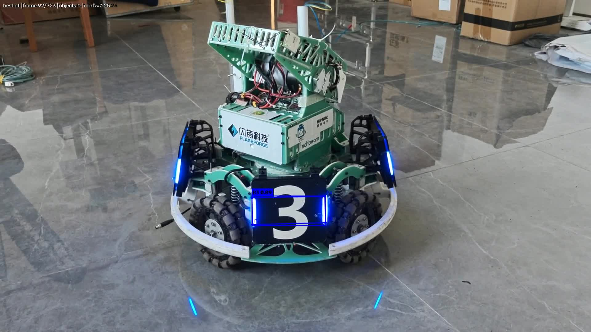

# YOLO26n 装甲板视频推理与关键点显示

使用课程统一提供的 YOLO26n-pose 装甲板模型（`best.pt`），对本人拍摄的装甲板视频逐帧推理，
绘制**检测框、类别、置信度**以及**模型预测的 4 个关键点**，并输出可直接播放的结果视频。



---

## 1. 项目功能

- 加载 YOLO26n-pose 装甲板模型权重，读取本地视频；
- 对视频逐帧执行推理（GPU）；
- 每个检测目标绘制：检测框、类别（B1/B2/B3/R1/R2/R3）、置信度；
- 绘制该目标**由模型预测得到的 4 个关键点**（标注 P1–P4，并用四边形连线标明归属）；
- 输出 H.264 编码的结果视频，保证浏览器/播放器可正常播放；
- 输出统计信息（处理帧数、各类检出次数、平均置信度、平均 FPS、耗时）。

## 2. 运行环境

| 项目 | 值 |
| --- | --- |
| 操作系统 | Ubuntu 22.04.5 LTS (jammy)，运行于 WSL2（内核 `6.18.33.2-microsoft-standard-WSL2`，真 Linux 内核） |
| Python | 3.10.12 |
| 深度学习框架 | torch **2.11.0+cu128**、torchvision 0.26.0+cu128 |
| 推理库 | ultralytics 8.4.175 |
| 图像/视频库 | opencv-python 5.0.0、numpy 2.2.6 |
| 视频转码 | ffmpeg（系统安装，`apt install ffmpeg`） |
| 计算设备 | **GPU：NVIDIA GeForce RTX 5060 Laptop GPU（8 GB 显存，驱动 596.56，CUDA 12.8 版 PyTorch）** |
| 是否支持 CPU | 支持，运行命令加 `--device cpu` 即可（速度较慢） |

## 3. 模型权重准备

- **来源**：课程统一提供的 `best.pt`（YOLO26n-pose 装甲板四角点模型）。
- **放置位置**：仓库根目录下的 `weights/best.pt`。
- **是否提交**：否。`weights/` 已被 `.gitignore` 排除，仓库中不含权重文件，需自行放入。

模型信息（可用下面的命令自行验证）：

```bash
python -c "from ultralytics import YOLO;m=YOLO('weights/best.pt');print(m.task, m.names, m.model.kpt_shape)"
# 输出：pose {0: 'B1', 1: 'B2', 2: 'B3', 3: 'R1', 4: 'R2', 5: 'R3'} [4, 2]
```

即：6 个类别（红/蓝双方各 3 个编号），每个目标 4 个关键点（每个关键点 2 个坐标）。

## 4. 安装与运行

### 4.1 安装依赖

```bash
# 系统依赖（libgl1 是 opencv-python 的运行库，缺失会报 libGL.so.1 错误）
sudo apt update
sudo apt install -y ffmpeg libgl1 libglib2.0-0 python3-venv python3-pip

# 创建并激活虚拟环境
python3 -m venv .venv
source .venv/bin/activate

# 安装 CUDA 版 PyTorch（注意必须指定 --index-url）
pip install torch torchvision --index-url https://download.pytorch.org/whl/cu128

# 安装其余依赖
pip install -r requirements.txt

# 验证 GPU 可用（应输出 True 与显卡名）
python -c "import torch;print(torch.__version__, torch.cuda.is_available(), torch.cuda.get_device_name(0))"
```

### 4.2 准备数据（不进 Git，需自行放置）

```bash
mkdir -p weights data runs
cp <best.pt 路径> weights/best.pt          # 模型权重
cp <自拍视频路径> data/armor_raw.mp4         # 本人拍摄的原始视频
```

### 4.3 运行推理

```bash
python infer.py \
  --weights weights/best.pt \
  --source data/armor_raw.mp4 \
  --output runs/result.mp4 \
  --conf 0.25 --imgsz 640 --device 0 \
  --save-frames assets
```

**参数说明**（模型路径、视频路径、输出位置均可通过参数修改）：

| 参数 | 默认值 | 说明 |
| --- | --- | --- |
| `--weights` | `weights/best.pt` | 模型权重路径 |
| `--source` | `data/armor_raw.mp4` | 输入视频路径 |
| `--output` | `runs/result.mp4` | 结果视频输出路径 |
| `--conf` | `0.25` | 置信度阈值 |
| `--imgsz` | `640` | 推理输入尺寸 |
| `--device` | `0` | `0` = 第一块 GPU，`cpu` = CPU |
| `--save-frames` | 空 | 保存代表性帧的目录（供 README 截图用） |
| `--max-frames` | `0` | 只处理前 N 帧（调试用，0 = 全部） |

### 4.4 结果保存位置

| 文件 | 说明 |
| --- | --- |
| `runs/result.mp4` | **推理结果视频**（H.264，含检测框/类别/置信度/4 个关键点） |
| `runs/result.stats.json` | 统计信息（帧数、各类计数、平均置信度、耗时、平均 FPS） |
| `assets/demo.jpg` | 代表性结果截图（README 引用，需提交） |

从结果视频中截取 README 用的截图（挑装甲板最大、关键点最清晰的时刻，`-ss` 后面是秒数）：

```bash
ffmpeg -y -ss 12 -i runs/result.mp4 -frames:v 1 assets/demo.jpg
```

## 5. 视频拍摄说明

| 项目 | 内容 |
| --- | --- |
| 拍摄地点 | 西北农林科技大学 水建学院 **D414 实验室** |
| 拍摄设备 | 本人手机（安卓），横屏手持拍摄 |
| 时长 | **24.1 秒** |
| 分辨率/帧率 | 1920×1080，约 30 fps，H.264 编码（avc1），58.3 MiB，共 723 帧 |
| 画面内容 | 装甲板特写与移动；包含**由远到近推进**与**左右绕视改变角度**两种情形，用于观察不同距离/角度下的识别表现 |
| 原创性声明 | 视频由本人于 D414 实验室自行拍摄，未使用网络素材或他人视频；原始视频另行作为作业附件提交 |

## 6. 代表性结果截图


说明：图中每个目标绘制 4 个关键点（标号 P1–P4），并用四边形连线表示它们属于同一个目标；
关键点来自模型 pose 头的直接输出（`results[0].keypoints.xy`），**不是检测框的四个角**。

## 7. 识别表现与问题记录

> 以下数据来自 `runs/result.stats.json`（真实运行结果，未作修改）。

| 指标 | 结果 |
| --- | --- |
| 处理帧数 | 723（视频全部帧） |
| 有检出的帧数 | 723（占比 **100%**） |
| 各类检出次数 | **B3：1067 次**（本段视频中仅出现该类别） |
| 平均置信度 | 0.796（中位数 0.859；10% 分位 0.576；最高 0.906；最低 0.251） |
| 置信度分布 | 0.70~0.90 占 **80.5%**；0.50~0.70 占 7.8%；低于 0.50 仅 **8.3%**（多为远距离小目标） |
| 每帧目标数分布 | 1 个目标 380 帧（52.6%）、2 个目标 342 帧（47.3%）、3 个目标 1 帧（0.1%） |
| 重复检出检查 | 同帧内检测框最大 IoU>0.5 的帧数为 **0**，不存在同一装甲板被重复框出的情况 |
| 平均推理速度 | 32.4 FPS（RTX 5060 Laptop，imgsz=640） |
| 总耗时 | 22.34 秒（723 帧推理 + 视频转码） |
| 含 4 个关键点的目标数 | 1067 / 1067（**100%**） |

**遇到的问题与处理（如实记录）：**

1. **类别一致性核对**：视频拍摄对象为 RoboMaster 机器人上的**蓝方 3 号装甲板**（白色数字 3 + 蓝色 LED 光条），
   模型将全部 1067 个目标识别为 **B3**，与实物一致，**未出现类别错误**（单帧置信度示例：0.87、0.90）。
2. **每帧目标数 1067 ÷ 723 ≈ 1.48 的原因**：机器人转向过程中，**正面与侧面两块装甲板会同时进入画面**。
   逐帧统计为：380 帧检出 1 个目标、342 帧检出 2 个、1 帧检出 3 个（380 + 2×342 + 3 = 1067，与总检出数吻合）。
   另统计了同一帧内检测框之间的最大 IoU，**IoU>0.5 的帧数为 0**，即不存在同一块装甲板被重复检出的情况。
3. **关键点表现**：4 个关键点均落在装甲板的四个角上，与装甲板边缘贴合良好；在侧视、倾斜角度下仍能正确贴合，
   且通过 P1–P4 标号与四边形连线可清楚分辨其归属。**未出现零检出帧（723/723 帧均有检出）**。
4. **已知不足与改进方向**：标记颜色与类别绑定（B3 → 蓝色），而蓝方装甲板本身带蓝色 LED 光条，
   在画面被缩小观看时标记不够醒目。后续可将关键点绘制为高对比色（如黄色/绿色），或为关键点增加白色描边以提升可辨识度。
5. **置信度分布说明**：中位数 0.859 高于均值 0.796，说明分布左偏——绝大多数检出集中在 0.70~0.90（占 80.5%），
   少数远距离小目标（10% 分位 0.576）拉低了平均值。检出置信度最低值 0.251（第 691 帧）仅略高于阈值 0.25，
   说明当前阈值几乎没有放行可疑目标；由该分布可知，低于 0.5 的检出占 8.3%，
   若把 `--conf` 提高到 0.5，这部分目标（主要是远景小目标）将不再被检出，属于可调的精度/召回权衡。
6. 排查过程记录：首次运行时按"权重 → 输入 → 参数"的顺序确认过——`weights/best.pt` 可正常加载（`task=pose`、6 类、`kpt_shape=[4,2]`）；视频被正确读取（1920×1080、30.01 fps、723 帧）；结果视频成功转为 H.264（`output_h264: true`）。

---

## 目录结构与提交范围

```
yolo-armor-inference/
├─ infer.py            推理脚本（提交）
├─ requirements.txt    依赖说明（提交）
├─ README.md           本文档（提交）
├─ .gitignore          忽略规则（提交）
├─ assets/             README 截图（提交）
├─ weights/            best.pt（不提交，需自行放置）
├─ data/               原始视频（不提交）
└─ runs/               结果视频与统计（不提交）
```
